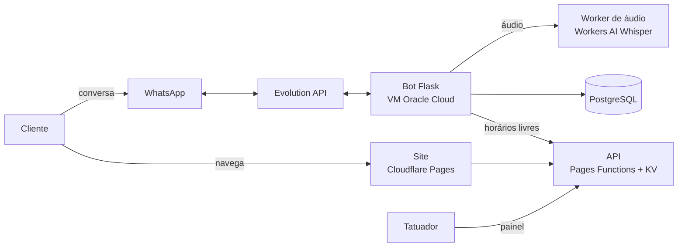

# Dizzy House Studio — site, painel e bot de agendamento

Sistema de atendimento e agenda para um estúdio de tatuagem. O cliente vê o portfólio e os horários livres no site, conversa com o bot no WhatsApp e reserva a sessão pagando um sinal por Pix. O tatuador acompanha tudo num painel.

O sistema está em uso no estúdio. Este repositório é uma cópia pública do código: dados de clientes, chaves e configurações do servidor ficaram de fora.


## O problema

O agendamento era feito à mão pelo WhatsApp. O tatuador respondia as mesmas perguntas várias vezes por dia (preço, horários, como pagar o sinal) e controlava a agenda de cabeça, com risco de marcar dois clientes no mesmo horário.

## O que o sistema faz

**Site público**
- Carrossel com os próximos 14 dias e os horários livres de cada um.
- Portfólio e catálogo, com um modelo 3D feito em Three.js.
- Botão que leva o cliente direto para a conversa com o bot.

**Painel administrativo**
- Dashboard com reservas e faturamento.
- Agenda: bloquear dias e horários e confirmar sessões.
- CRM com o histórico de cada cliente.
- Editor do portfólio.
- Login com conta Google, restrito ao e-mail do estúdio.

**Bot de WhatsApp**
- Máquina de estados ligada à Evolution API, com 3 fluxos: atendimento normal, simulação de orçamento e cliente vindo do site.
- Orçamento por tamanho e estilo da tatuagem.
- Consulta os bloqueios da agenda em tempo real (`GET /api/bloqueios`) antes de oferecer um horário.
- Só aceita uma reserva confirmada por horário, o que evita conflito de agenda.
- Pede o sinal de R$ 100 por Pix para confirmar a sessão.
- Transcreve áudios do cliente com o Whisper do Workers AI.
- Responde dúvidas frequentes por palavra-chave e passa a conversa para o tatuador quando precisa.

## Arquitetura



## Estrutura

```
site/           Site público, painel (admin.html) e API em Cloudflare Pages Functions
  functions/api/  Rotas da API (agenda, bloqueios, portfólio, login)
bot/            Bot de WhatsApp em Python + Flask
worker-audio/   Cloudflare Worker que transcreve áudios
```

## Como rodar

**Site e API**

1. Crie um namespace KV e coloque o id em `site/wrangler.toml`.
2. Defina as variáveis de ambiente no Cloudflare Pages: `ADMIN_USER`, `ADMIN_PASS` e `ALLOWED_EMAIL`.
3. Troque `SEU_GOOGLE_CLIENT_ID` em `site/admin.html` pelo seu client ID do Google.
4. Publique com `npx wrangler pages deploy site`.

**Bot**

```bash
cd bot
pip install -r requirements.txt
cp .env.example .env   # preencha com os dados da sua Evolution API e do banco
python webhook_server_drezin.py
```

**Worker de áudio**

```bash
cd worker-audio
npx wrangler secret put AUTH_TOKEN
npx wrangler deploy
```

## Stack

| Parte | Tecnologia |
|---|---|
| Site | HTML, CSS e JavaScript puro, Three.js |
| API | Cloudflare Pages Functions + KV |
| Bot | Python, Flask, Evolution API |
| Banco do bot | PostgreSQL |
| Áudio | Cloudflare Workers AI (Whisper) |
| Servidor do bot | VM Oracle Cloud Free Tier |

---

Feito por [Brian Valente](https://github.com/brianxavier18) · [portfólio](https://valenteos-portfolio.pages.dev)
